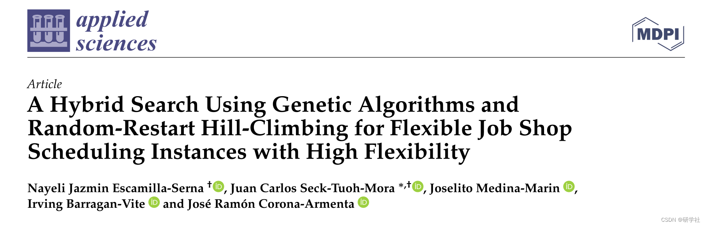
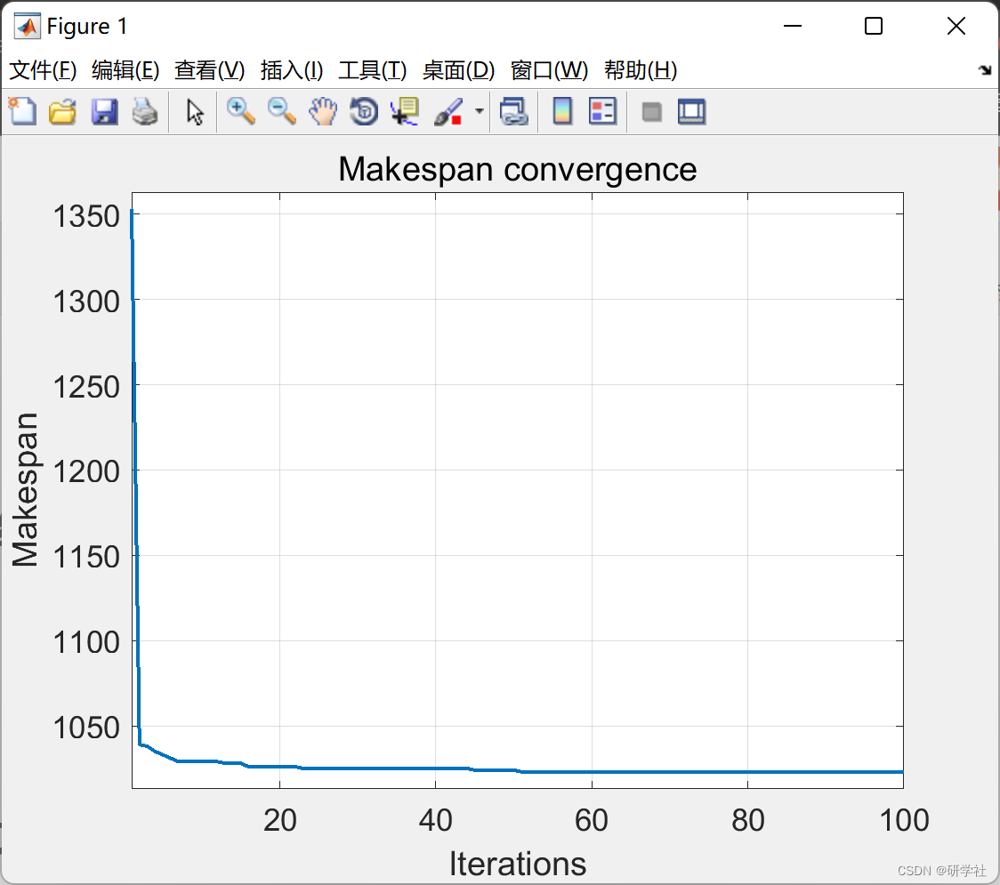
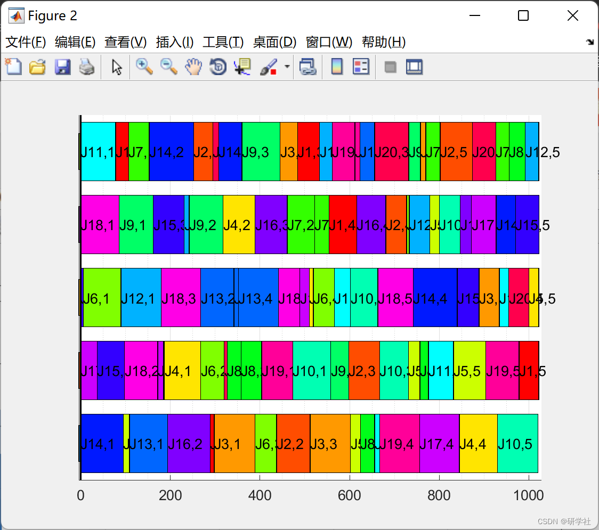
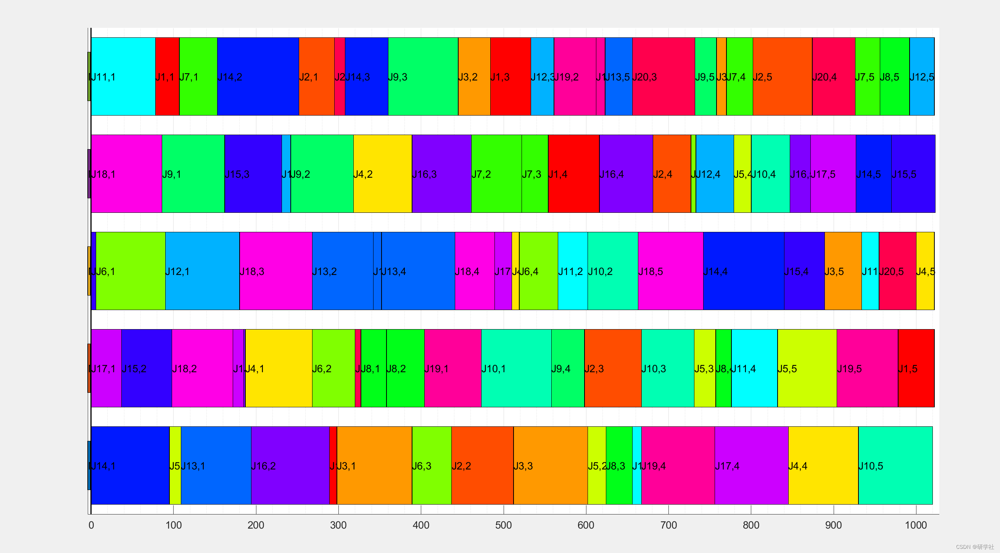

# Research on flexible workshop scheduling based on genetic algorithm, cellular automata neighborhood and random restart hill climbing optimization algorithm (Matlab code implementation)

💥💥💞💞 Welcome to this blog❤️❤️💥💥
🏆 Bloggers' Advantages: 🌞🌞🌞 The content of the blog strives for rigorous thinking and clear logic, making it convenient for readers.
⛳️ Mantra: "A journey of a thousand miles begins with a single step." Directory 💥1 Overview📚2 Run-time Results🎉3 References🌈4 MATLAB Code Implementation
​Edited by
This article proposes a new hybrid algorithm GA-RRHC, which is based on genetic algorithms (GA) and random restart hill climbing (RRHC) algorithms, optimized for flexible job shop scheduling problems (FJSSP), where each operation can be completed by a large number of machines. In particular, different GA crossover and simple mutation operators are used in conjunction with cellular automata (CA)-inspired neighborhoods to perform global searches. This method improves computational implementation through local searches based on RRHC. By applying CA-type neighborhoods in GA-RRHC and blending the above two techniques, new points are obtained, which are easy to understand and implement. GA-RRHC was tested using four groups of experiments widely used in literature, and its results were compared with six recent algorithms using relative percentage deviation (RPD) and Friedman test. The experiments show that for FJSSP instances, GA-RRHC is a competitive method compared to other recent algorithms, demonstrating high flexibility.
This paper proposes a new hybrid technique, called GA-RRHC, which combines two metaheuristic techniques: the first is global search using genetic algorithm (GA) operators, and the second is a neighborhood based on cellular automata (CA) concepts, mainly used for programming operation sequences. As a second step, each solution refines by applying local search with random restart climb (RRHC), especially to select the most suitable machine for critical operations, which is more convenient for highly flexible problems. Restarting is used as a simple strategy to avoid premature convergence of solutions. The contribution of this study lies in the initial use of two easy-to-implement operators to define a robust hybrid technique that can find satisfactory solutions for instances of FJSSP, minimizing all job processing times (or manufacturing times).
The structure of this article is as follows: Section 2 provides the formal representation of FJJSP. Section 3 introduces a new GA-RRHC method, explaining the genetic operators used, the CA-inspired neighborhood for the solution population evolution, and the operations of RRHC to refine each solution. Section 4 discusses parameter tuning for GA-RRHC, comparing it with other six recently published algorithms from four FJSSP datasets in literature, and conducting statistical analysis based on non-parametric Friedman test and relative percentage deviation (RPD). Section 5 presents the conclusions of this paper.📚2 Run results
Editor
Edit the code section:
archivo=fopen(nombreArchivo,'r');  
datos=fscanf(archivo,'%f');  
numeroTrabajos=datos(1);  
numeroMaquinas=datos(2);  
vectorOperaciones=[];  
%Indices to take jobs, operations and positions  
indice=4;  
nt=1;  
%Loop for jobs  
while(nt<=numeroTrabajos)  
vectorNumOperaciones(nt)=datos(indice);  
vectorInicioOperaciones(nt)=sum(vectorNumOperaciones(1:nt-1));  
operacionesTrabajo=ones(1,vectorNumOperaciones(nt))*nt;  
vectorOperaciones=[vectorOperaciones operacionesTrabajo];  
%Loop for operations  
for numOper=1:vectorNumOperaciones(nt)  
indice=indice+1;  
numMaq=datos(indice);  
%Loop for machines  
for i=1:numMaq  
indice=indice+1;  
maquina=datos(indice);  
indice=indice+1;  
tiempo=datos(indice);  
tablaTiempos(vectorInicioOperaciones(nt)+numOper,maquina)=tiempo;  
end  
end  
%Next job  
indice=indice+1;  
nt=nt+1;  
end  
%Operation number  
numeroOperaciones=length(vectorOperaciones);  
%Available machines per operation  
tablaMaquinasFactibles=[];  
for oper=1:length(tablaTiempos)  
indices_factibles = tablaTiempos(oper,:) ~= 0;  
tablaMaquinasFactibles=[tablaMaquinasFactibles; indices_factibles];  
end  
end  
%Algorithm GA_RRHC  
function [mejorSO, mejorSM, mejorMakespan, PoblacionSO, PoblacionSM, PoblacionMakespan, convergencia, contIt] = GA_RRHC(numIndividuos, numGeneraciones, numEstancamiento, probElitista, numeroTrabajos, numeroMaquinas, numOperaciones, vectorNumOperaciones, vectorInicioOperaciones, vectorOperaciones, tablaTiempos, tablaMaquinasFactibles,numVecinos,probMutacion,iteracionesTotalesEscalada,iteracionesReinicioEscalada,probOperCrit,bandImp)  
%Initialize values  
mejorSO = [];  
mejorSM = [];  
mejorMakespan = inf;  
convergencia = [];  
%Population vectors  
PoblacionSO=zeros(numIndividuos,numOperaciones);  
PoblacionSM=zeros(numIndividuos,numOperaciones);  
PoblacionMakespan=zeros(numIndividuos,1);  
%Table with the characteristics of each solution concerning the jobs,  
%It is sorted by jobs and the order of their operations (J_11, J_12, ... Jnm-1, Jnm)  
%Rows keep in this order the information:  
%Machine assigned  
%Processing position on the assigned machine  
%End of operation time  
%Operation duration  
%Tail time  
%Operation position in SO  
%Operation position in SM  
PoblacionTablaTrabajos=zeros(6,numOperaciones,numIndividuos);  
%Table with the characteristics of each solution concerning the machines,  
%It is sorted by machines and the order of their operations (M_11, M_12, ... Mmo-1, Jmo)  
%Rows keep in this order the information:  
%Scheduled work  
%Operation of scheduled work  
%Final operation time  
%Operation duration  
%Tail time  
%Operation position in SO  
%Operation position in SM  
PoblacionTablaMaquinas=zeros(6,numOperaciones,numIndividuos);  
🎉3 References  
🌈4 Matlab code implementation

## Images

<!-- PAYMENT_BLOCK -->

## Get this dataset

- Payment link (Stripe): [Buy now](https://buy.stripe.com/3cs8yP7sY87d0vu9AB)
- Payment QR code: 

<!-- /PAYMENT_BLOCK -->
